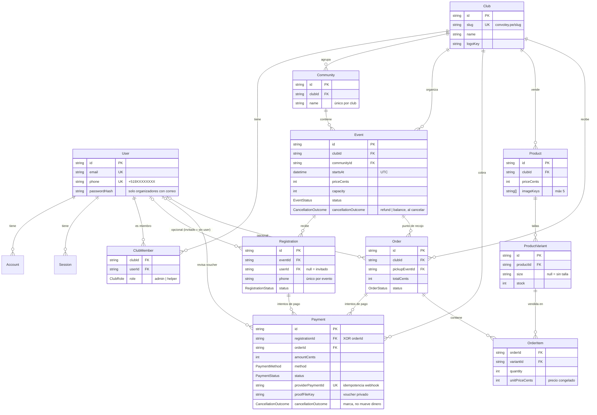

# Modelo de datos

Fuente de verdad: [`prisma/schema.prisma`](../prisma/schema.prisma). Migraciones versionadas en `prisma/migrations/`. Este documento explica el porqué; si cambias el schema, actualiza el diagrama.

## Convenciones

- **Dinero**: `Int` en céntimos de sol, con sufijo `Cents` (`priceCents`, `amountCents`). Nunca `Float`.
- **Fechas**: `DateTime` en UTC. Se muestran en `America/Lima` (UTC−5 todo el año) en la interfaz.
- **Celulares**: guardados normalizados `+519XXXXXXXX`. Un `CHECK` en SQL lo exige en `User`, `Registration` y `Order`.
- **Archivos**: solo la key del bucket (`logoKey`, `imageKeys`, `proofFileKey`), nunca una URL. Los vouchers se leen con URL firmada (HT-04).
- **IDs**: `cuid()` en texto.
- **Borrado**: `Cascade` solo en hijos sin historial (`Account`, `Session`, `ClubMember`, `Community`, `ProductVariant`, `OrderItem`). `Restrict` en todo lo que tiene dinero o historial. `SetNull` en los vínculos opcionales a `User`. Los clubes y convocatorias no se borran: se cancelan.

## Diagrama

`VerificationToken` (Auth.js, también para recuperar contraseña) no tiene relaciones y se omite del diagrama.

## Tablas por módulo

| Módulo | Tablas | Historias |
|---|---|---|
| `identity` | `User`, `Account`, `Session`, `VerificationToken` | HU-01, HU-48 |
| `clubs` | `Club`, `ClubMember`, `Community` | HU-01, HU-02, HU-09, HU-33 |
| `events` | `Event` | HU-03, HU-04, HU-05 |
| `registrations` | `Registration` | HU-06, HU-07, HU-08, HU-48 |
| `payments` | `Payment` | HU-08, HU-14, HU-15, HU-19, HU-20 |
| `store` | `Product`, `ProductVariant`, `Order`, `OrderItem` | HU-23, HU-24, HU-25 |

Cada módulo solo lee y escribe sus propias tablas (ver `docs/ARQUITECTURA.md`). `Event.clubId` se repite aunque se pueda sacar de la comunidad, para que `events` filtre por club sin consultar tablas de `clubs`.

## Decisiones

- **Invitado**: una `Registration` con `userId = null`. No hay tabla de invitados. En HU-48 se vincula por `phone`.
- **Inscripción duplicada**: `@@unique([eventId, phone])` la rechaza en la base incluso si llegan dos a la vez. Si alguien cancela y vuelve, se reactiva la misma fila.
- **Pagos**: una tabla para inscripciones y pedidos; un `CHECK` exige exactamente uno de `registrationId` u `orderId`. Una fila por intento: un voucher rechazado queda como historial y el siguiente es otra fila.
- **Webhook idempotente**: `providerPaymentId @unique`.
- **Convoley no retiene dinero**: no hay saldos ni cuentas internas; `Payment` solo registra lo que pasó en la cuenta de Mercado Pago del organizador.
- **Cancelar una convocatoria (HU-05)**: el organizador elige `refund` (devolución) o `balance` (saldo a favor). Se guarda en `Event.cancellationOutcome` (lo que ven los inscritos) y en cada `Payment` `approved` o `in_review` aún sin marcar, en la misma transacción. Es solo una marca: la devolución la hace el organizador en Mercado Pago. HU-14 debe marcar igual un pago que se apruebe después de la cancelación.
- **Confirmados**: las inscripciones que ocupan cupo son las que no están `cancelled` (pagadas o no). Los cupos no pueden bajar de ese número.
- **Estado `full`**: se guarda en `Event.status` (HU-04). Editar los cupos lo recalcula (HU-05). El caso de uso de inscripción (HU-06) debe contar y crear dentro de una transacción que bloquee la fila del evento (`SELECT ... FOR UPDATE`), para no sobrepasar el cupo.
- **CHECKs a mano**: formato de celular y XOR de pago al final de `*_init`; montos, cupo, stock y cantidades no negativos en `*_range_checks`. Prisma no los administra, así que las migraciones futuras no los borran.
- **Consistencia entre clubes**: la base no impide que `Payment.clubId` difiera del club de su inscripción o pedido, ni que `Order.pickupEventId` sea de otro club. Lo validan los casos de uso que crean esas filas (HU-08, HU-24).

## Pendiente: lo agrega la historia que lo usa

| Qué | Historia |
|---|---|
| Posición y nivel del jugador | HU-10 |
| Lista de espera (`WaitlistEntry`) | HU-12 |
| Configuración de Yape / QR | HU-13 |
| Conexión OAuth de Mercado Pago (tokens cifrados) | HU-18 |
| Reserva temporal de cupo (`reservedUntil`) | HU-21 |
| Comisión de servicio | HU-22 |
| Planes y créditos | HU-26, HU-27 |
| Convocatorias recurrentes | HU-28 |
| Token de cancelación | HU-29 |
| Política de cancelación y saldo a favor | HU-30 |
| Equipos | HU-31 |
| Costo de cancha | HU-34 |
| Suscripción de Convoley | HU-35 |
| Check-in | HU-38 |

## Comandos

- `npx prisma migrate dev --name <nombre>` · nueva migración (luego `npx prisma generate`)
- `npx prisma db seed` · datos de prueba (idempotente; no corre en producción)
- `npm run test:integration` · migra y siembra una base `convoley_test` vacía
